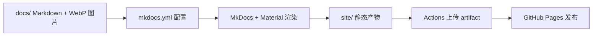

## 产品概述

将现有文档仓库搭建为可自动发布的世界观 Wiki 站点：作者只提交 Markdown 文件，站点导航、目录索引与全文搜索均由目录结构自动生成，推送至 GitHub 后由 Actions 自动构建并发布到 GitHub Pages。

## 核心功能

- **目录即导航**：新增 `docs/` 下任意文件夹与 Markdown 文件，无需修改任何配置，侧边导航与分类索引自动更新。
- **自动全文搜索**：搜索框同时检索标题、小标题与正文，支持中文分词与结果高亮，无需逐页登记。
- **自动构建发布**：推送 `main` 分支触发 Actions，构建产物直接部署至 Pages，无需本地构建、无需手动推送发布分支。
- **阅读体验**：默认深色终端风格，可切换浅色；设定图统一为 WebP，加载更快且可点击查看大图。
- **分类入口**：首页呈现设定词、物品、事件、小说四个分类入口与站点简介。

## 边界与约定

- 仅保留一套构建配置，不引入自定义脚本或自定义主题扩展。
- 文档内容与图片保持原有组织方式，图片由 PNG 转为 WebP 并同步更新引用。
- 站点地址与仓库地址以占位符形式填写，上线时由使用者替换为实际 GitHub 用户名。

## 技术选型

- 静态站点生成器：MkDocs 1.6 + Material 主题（Python，无 Node 依赖）。
- 中文搜索：Material 内置 `search` 插件，`lang: zh` 配合 `jieba` 分词，构建期自动生成索引，覆盖标题与正文。
- 部署：GitHub Actions 官方 Pages 流程（`configure-pages` + `upload-pages-artifact` + `deploy-pages`），不使用 `gh-pages` 分支与个人令牌。
- 图片：`Pillow` 一次性转 WebP 后入库，构建期无需额外处理。

## 实现思路

1. **零配置导航**：`mkdocs.yml` 中不声明 `nav`，MkDocs 依据 `docs/` 目录树自动生成导航；每个目录放置 `index.md`，配合 Material 的 `navigation.indexes` 特性，使目录本身成为可点击的分区页，形成"目录结构即索引结构"。
2. **自动搜索**：仅需开启 `search` 插件并声明中文语言，索引在构建时生成，页面标题、各级小标题与正文段落分别入库，前端按相关度排序并高亮命中的关键词。
3. **一次配置长期有效**：新增文档只落入对应文件夹，导航与搜索索引在下次构建时自动包含，无需改动任何配置文件。
4. **外观以 CSS 变量覆写**：Material 提供完整的配色变量体系，深色终端风通过 `extra.css` 的变量赋值实现，不继承或改写主题模板，升级主题时不受影响。
5. **性能**：站点为纯静态产物，无运行时框架；关闭 Google Fonts 外链，改用系统字体栈，避免外部网络阻塞首屏；图片转 WebP 后单页体积由数十兆降至数百千字节。

## 架构设计

构建链路为单向流水线：Markdown 与图片 → MkDocs 解析与主题渲染 → `site/` 静态产物 → Actions 上传 → Pages 分发。



发布流水线关键步骤：

```
- uses: actions/setup-python@v5
  with: { python-version: "3.12", cache: pip }
- run: pip install -r requirements.txt
- run: mkdocs build
- uses: actions/upload-pages-artifact@v3
  with: { path: site }
```

## 目录结构

```
CodeOfAnotherWorld/
├── mkdocs.yml                        # [NEW] 站点配置：站点名、中文、深色主题、搜索插件、Markdown 扩展。不写 nav，导航由目录自动生成。
├── requirements.txt                  # [NEW] 构建依赖：mkdocs-material、jieba。版本上界锁定，保证 Actions 构建可复现。
├── .gitignore                        # [MODIFY] 追加 site/、.cache/、__pycache__/，避免构建产物入库。
├── .github/
│   └── workflows/
│       └── deploy-pages.yml          # [NEW] 推送 main 触发构建并部署 Pages；含 pages 写权限、并发控制、artifact 上传。
└── docs/
    ├── index.md                      # [MODIFY] 由 README.md 升级：站点标题、简介、四类入口卡片、更新说明。
    ├── stylesheets/
    │   └── extra.css                 # [NEW] 深色终端风配色变量、系统字体栈、正文排版、图片圆角与描边、表格与代码块样式。
    ├── word/
    │   ├── index.md                  # [MODIFY] 空 README.md 改为分区首页：设定词分类说明。
    │   └── Animal.md                 # [MODIFY] 图片引用改为 WebP 相对路径。
    ├── event/
    │   └── index.md                  # [MODIFY] 空 README.md 改为分区首页：环境事件分类说明。
    ├── item/
    │   ├── index.md                  # [MODIFY] 由 README.md 升级：物品分类说明。
    │   ├── Terminal.md               # [MODIFY] 两处图片引用改为 WebP。
    │   ├── TransportShip.md          # [MODIFY] 六处图片引用改为 WebP。
    │   └── imgs/                     # [MODIFY] 8 张 PNG 转为同名 WebP 后移除 PNG。
    └── novel1/
        └── index.md                  # [NEW] 占位分区页，保证小说分类在导航中可见且可后续追加章节。
```

## 实施要点

- `site_url` 与 `repo_url` 以 `https://<用户名>.github.io/CodeOfAnotherWorld/` 形式填入占位符，并在文件头注释说明替换位置。
- 主题设置为 `font: false` 以避免境外字体请求；深浅两套 palette 中深色置于首位，保证默认深色且保留切换按钮。
- `mkdocs build` 不加 `--strict`，避免空页或历史链接告警中断构建。
- 图片转换使用 Pillow 脚本一次性执行：质量 82、保留原尺寸、同名替换，转换后核对 9 处引用无遗漏，中文文件名改为英文短名以避免 URL 编码问题。
- `.github/workflows` 中仅授予 `contents: read`、`pages: write`、`id-token: write`，并设置 `concurrency` 避免并发部署互相覆盖。
- 上线前置条件写入方案说明：仓库 Settings 中 Pages 的 Source 需选择 GitHub Actions，且远端仓库建立后首次推送 `main` 即自动完成首次发布。

## 设计风格

以"终端档案"为主题：深色为默认基调，接近深空的冷黑背景配合青色强调，呈现星际终端与档案库的质感；排版克制，优先保证长文阅读的舒适度，不使用装饰性动效堆叠。

## 页面结构

- **顶部导航条**：站点名、四个分类标签、搜索框、深浅切换按钮、GitHub 入口。窄屏折叠为抽屉。
- **左侧导航**：按目录自动生成的多级列表，当前页高亮为青色，分组标题使用较小字号与字距区分。
- **正文区**：可读宽度约 760 像素，标题层级清晰，段落行高充裕；设定图统一圆角与细描边，横向铺满内容宽度。
- **右侧目录**：当前页小标题索引，滚动时随内容高亮定位。
- **首页**：站点标题与一句话简介，下方四张分类入口卡，点击进入对应分区；卡片在悬停时边框转为青色并轻微上浮。

## 交互细节

- 搜索输入即时展开结果面板，命中词高亮，支持键盘上下选择。
- 深浅模式切换记忆用户选择，图标随目标模式变化。
- 图片点击可放大查看，说明文字紧随图片下方。
- 所有可点击元素具备清晰的悬停与聚焦态，聚焦时显示青色描边，保证键盘可操作性。